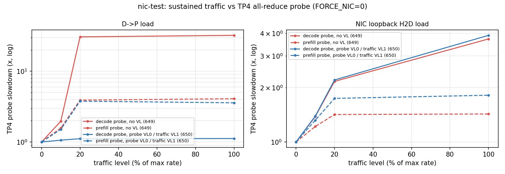
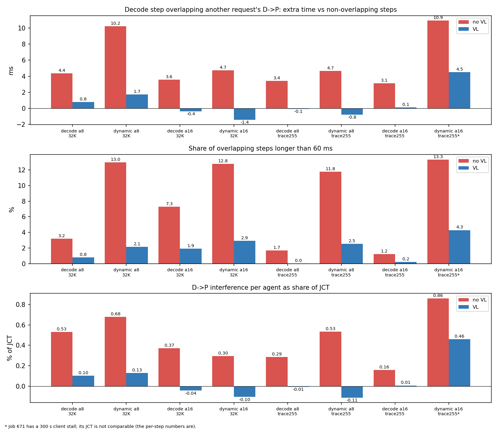
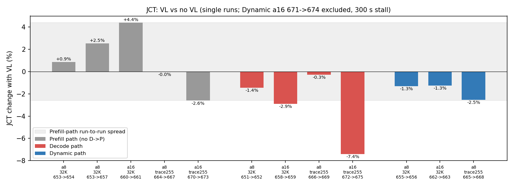

# InfiniBand VL 流量隔离：实验总结（汇报版）

2026-10-01，pza100（g5 Prefill / g6 Decode，各 4×A100-PCIe-40GB），Qwen2.5-32B TP4。
详细设计与原始数据见 [vl-traffic-isolation.md](vl-traffic-isolation.md)（§4.5 配置、§6.0 / §6.1 数据）。

---

## 1. 一页结论

- **VL 在机制上有效**：D→P 传输期间，被拖慢的 decode step 多出的耗时从 3–11 ms 降到约 0；
  其中超过 60 ms 的长 step 在 Dynamic 路径上从 12–13% 降到 2–4%。
- **VL 基本不改变 JCT**：D→P 和 NIC H2D 都是瞬时突发（每次 55–150 ms），只出现在发起请求自己的
  TTFT 里；对其他请求的干扰折算到 JCT 只有 **0.16–0.86%**，VL 能省下的只有其中的 0.15–0.64%。
- **实测 JCT 差异在噪声内**：开 VL 后 Decode / Dynamic 的 JCT 变化为 −0.3% 到 −2.9%，
  而完全没有 D→P 的 Prefill 路径，单次 run 之间也有 −2.6% 到 +4.4% 的波动。
- **何时 VL 会变重要**：D→P 占空比 ≈ L3 带宽 ÷ D→P 带宽。当前 L3 限速 8 GB/s 时上限约 11%；
  放开到约 36 GB/s 后约 50%，此时 nic-test 中无 VL 的 32 倍拖慢就会在真实负载中出现。

---

## 2. 问题：PD 流量为什么会干扰 TP 计算

- 平台特点：GPU 与 CX8 之间只有 PCIe Gen4 x16，链路本身不是瓶颈，**PCIe 是瓶颈**。
- 三种干扰机理：

| 机理 | 典型场景 | VL 能否解决 |
|---|---|---|
| credit 反压导致的队头阻塞 | D→P 写入 g5 GPU 被 PCIe 卡住，反压堵住 g6 同一端口上的 NCCL 发送 | **能**（不同 VL 有独立 credit） |
| 接收端 GPU 的 PCIe 争用 | D→P 与 Prefill 的 NCCL 接收争用同一块 GPU 的 PCIe | 不能 |
| HCA 内部回环 | NIC H2D、`FORCE_NIC=1` 下的节点内 NCCL | 不能 |

- 因此两条 VL（NCCL 在 VL0，KV 流量在 VL1）就足以解决第一类问题，不需要论文中的 4 条 VL 和严格优先级。

---

## 3. 方案与配置

- 6 个开关：`DUAL_PATH_VL_{P_NCCL,D_NCCL,P2D,D2P,P_NIC_H2D,D_NIC_H2D}`，由
  `pd_network_config.sh` 换算成每个进程的 `NCCL_IB_SL` 与 `MC_IB_SL`。
- 限制：Mooncake 每个进程只有一个 SL，因此 `P_NIC_H2D` 必须等于 `P2D`，`D_NIC_H2D` 必须等于 `D2P`。
- 本次实验配置：`P_NCCL=D_NCCL=0`，`P2D=D2P=P_NIC_H2D=D_NIC_H2D=1`。
- SM 无需改动：当前 SL0→VL0、SL1–7→VL1，VLArb 为 VL0:VL1 = 160:112 的加权轮询，没有优先级。
- 已确认 SL 生效：Job 652 之后，g5 所有平面的 `PortXmitDataSL` 中 SL1 计数从 0 变为非零。

---

## 4. 微基准（nic-test）：持续打满时 VL 的效果



| 干扰流量（跑满） | 受影响的一侧 | 无 VL（649） | 有 VL（650） |
|---|---|---|---|
| D→P | Decode：跨节点 NCCL 与 D→P 共用发送端口 | 32.2× | **1.12×** |
| D→P | Prefill：NCCL 与 D→P 争用同一 GPU 的 PCIe | 4.09× | 3.58× |
| NIC 回环 H2D | Decode / Prefill | 3.72× / 1.43× | 3.90× / 1.82× |

- 结论：VL 消除了队头阻塞（32× → 1.12×），但对 PCIe 争用和 HCA 回环无效，与机理分析一致。

---

## 5. 真实 PD 负载：机制层面的效果

- 16 个 run，8 对开/关 VL 对照：32K 数据集和 trace255 数据集（94 turns），各取 a8、a16，
  每组包括 Decode 和 Dynamic 路径。
- 配置：TP4、`KVTRANS=full`、L3 限速 8 GB/s、NFS/RDMA、NIC H2D stream。



- 第一行：与 D→P 重叠的 step 多出的耗时，从 3.1–10.9 ms 降到约 0（674 剩 4.5 ms）。
- 第二行：其中超过 60 ms 的长 step，Decode 路径从 1.2–7.3% 降到 0–1.9%，
  Dynamic 路径从 11.8–13.3% 降到 2.1–4.3%。
- 第三行：干扰折算到 JCT 只有 0.16–0.86%，开 VL 后降到约 0–0.46%。
- D→P 自身耗时不变（57–78 ms，瓶颈在 g5 GPU 的 PCIe 写入）。被 D→P 重叠的 Prefill forward
  只有 3–53 个，每 token 耗时与不重叠的相同。

---

## 6. 为什么基本不影响 JCT

- **只出现在自己的 TTFT 里**：`KVTRANS=full` 下，请求自己的 forward 不与自己的 D→P、H2D 重叠。

| 指标 | 范围（16 个 run） |
|---|---|
| D→P 每次耗时 / 占自身 TTFT | 57–78 ms / 0.6–4.1% |
| Decode 侧 NIC H2D 每次耗时 / 占自身 TTFT | 76–107 ms / 0.8–5.4% |
| Prefill 侧 NIC H2D（Dynamic 路径） | 105–151 ms |
| D→P 时间占空比 | 2.6–8.3% |
| 与 D→P 重叠的 decode step 占比 | 3.3–13.4% |

- **干扰占 JCT 的比例可以分解为三项**：

  \[
  \frac{\text{干扰}}{\text{JCT}} \approx f_{dec} \times \text{duty} \times \frac{\Delta}{\text{ITL}}
  \]

  - \(f_{dec}\)：agent 时间中处于 decode 的比例。本负载平均只输出 52 token，所以只有 12–47%，
    其余时间主要是 TTFT 中的排队。
  - duty：一个 decode step 碰上 D→P 的概率，即上表中重叠 step 的占比，3–13%。
  - \(\Delta/\text{ITL}\)：被重叠的 step 变慢的比例，无 VL 时约 12–35%，开 VL 后约 0。
  - 校验：672 的估算值为 \(0.12 \times 0.126 \times 0.13 \approx 0.19\%\)，逐 step 实测为 0.16%。

---

## 7. JCT 对比



- 灰带：没有 D→P 的 Prefill 路径开/关 VL 时的 JCT 变化，反映单次 run 的噪声（−2.6% 到 +4.4%）。
- Decode 和 Dynamic 路径的 7 对中有 6 对落在灰带内，与"VL 只能省 0.15–0.64%"的估算一致。
- 两个例外：
  - **672→675（−7.4%）**：两次 run 的 L3 读取总耗时都是 710 s（串行），差值来自读取之间的空闲
    （p50 223 ms 对 150 ms）。其中只有约 11 ms 能用 VL 解释，其余部分没有打点，原因待查。
  - **671→674（未列出）**：671 有一个请求卡在 Prefill bootstrap，客户端等满 300 s 后重试，
    JCT 因此多出 300 s，这一对不可比。

各场景的 JCT / TTFT / TPOT 对比图：

| 数据集 | a8 | a16 |
|---|---|---|
| 32K | [a8](../results/pd-case-comparison/prefill-dynamic-decode-vl-compare-32k-a8-kvtrans-full.svg) | [a16](../results/pd-case-comparison/prefill-dynamic-decode-vl-compare-32k-a16-kvtrans-full-20261001.svg) |
| trace255（94 turns） | [a8](../results/pd-case-comparison/prefill-dynamic-decode-vs-vl-32k-trace255-a8-94turn.svg) | [a16](../results/pd-case-comparison/prefill-dynamic-decode-vs-vl-32k-trace255-a16-94turn.svg) |


---

## 8. 外推：什么情况下干扰会变明显

- **增加 agent 数：不会明显变大。** Decode 路径的 L3 读取是串行的，D→P 跟在每次读取之后，所以
  D→P 占空比 ≈ \(B_{L3} / B_{D\to P}\) ≈ 8 / (4 × 18) ≈ 11%，trace255 a16 已经达到 8.3%。
  多出来的 agent 主要变成排队，Decode GPU 只能同时容纳十几个 32K 请求，因此干扰占 JCT 的比例反而下降：
  trace255 从 a8 到 a16，该比例从 0.29% 降到 0.16%。
- **改变输出长度：影响有限。** 输出变长时 \(f_{dec}\) 上升，但请求变稀疏使 duty 下降，两者相互抵消。
  各项都取极值时上界约 4%，但两个极值条件互相矛盾（L3 跑满需要短输出），实际约 1% 量级。
- **提高 L3 带宽：会明显变大。** NFS/RDMA 并发读实测约 36 GB/s，届时 duty 上限约 50%，
  接近 nic-test 中持续打满的场景，VL 的作用会从不到 1% 变为决定性的。

---

## 9. 局限与下一步

- 局限：
  - 每个点只跑了 1 次。
  - NIC H2D 没有时间戳，对其他请求的干扰只能通过它的 TTFT 占比和 nic-test 来间接判断。
  - 当前只有 2 条 VL，且没有优先级仲裁。
- 建议的下一步：
  1. 保持 a16，把 L3 限速提到 16 / 32 GB/s 或者放开，开、关 VL 各跑一组，验证外推结论。
  2. 重跑 671，并在开、关 VL 之间交替各跑 2–3 次，把噪声量化出来。
  3. 给 Decode 调度器补打点（请求到达 → 进入 L3 读取队列），查清 672/675 的空闲差异。
  4. 排查 671 中 Prefill bootstrap 卡住 300 s 的问题。

---

## 附：数据与复现

| Job | 内容 |
|---|---|
| 649 / 650 | nic-test，无 VL / 探针 VL0 + 流量 VL1（`FORCE_NIC=0`） |
| 651–663 | 32K 数据集，a8、a16，三种路径开/关 VL（Prefill 路径 653 无 VL，654 / 657 有 VL） |
| 664–669 | trace255，a8，三种路径开/关 VL |
| 670–675 | trace255，a16，三种路径开/关 VL |

```bash
cd nic-test
python3 summarize_vl_pd.py 651 652 655 656 658 659 662 663 666 669 665 668 672 675 671 674
python3 plot_vl_report.py            # 生成 docs/figures/vl-report-{nictest,mechanism,jct}.{svg,png}
python3 analyze_real_d2p.py <run_dir> <decode-0.log> --prefill-log <prefill-0.log> --baseline <prefill-path run_dir>
```
